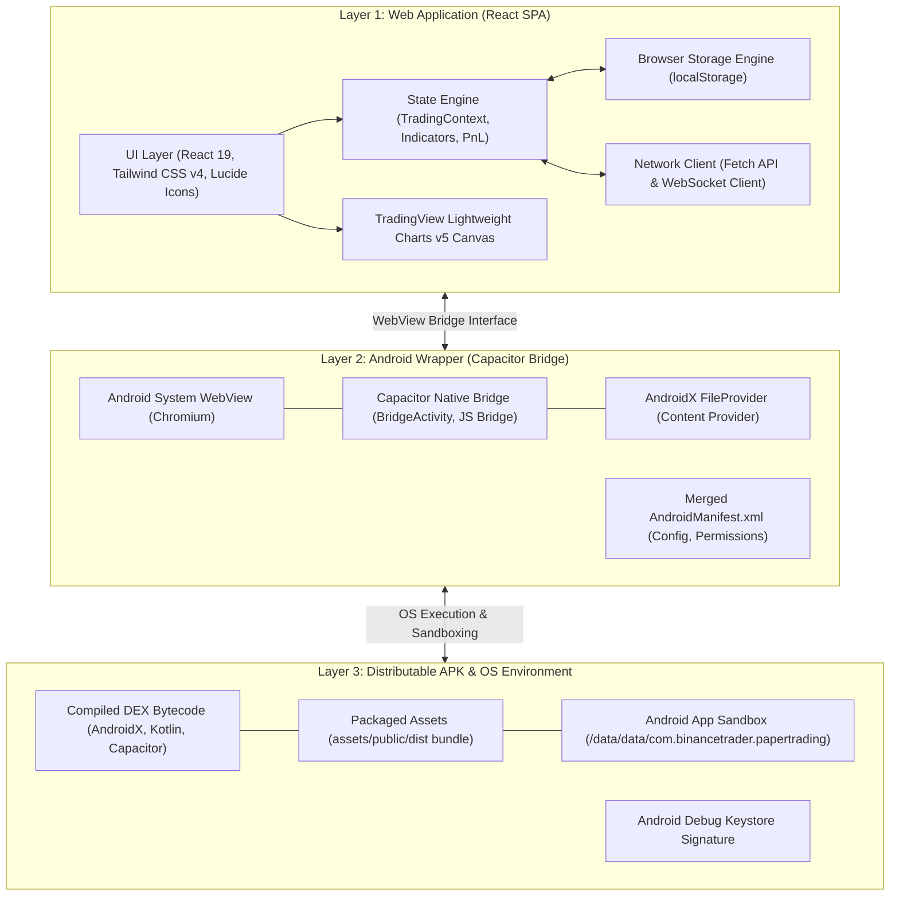
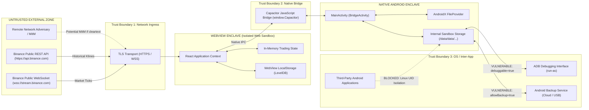

# APPLICATION ARCHITECTURE & TRUST BOUNDARY REPORT
**Project:** Binance SOL/USDT Day Trader & Paper Trading App  
**Package ID:** `com.binancetrader.papertrading`  
**Audit Phase:** Phase 1 — Architecture Discovery  
**Date:** October 14, 2026

---

## 1. Architectural Overview

The application is structured in three distinct architectural layers:

---

## 2. Layer-by-Layer Architectural Breakdown

### Layer 1: Web Application
- **Runtime Environment:** Single Page Application (SPA) executed inside the Chromium-based Android System WebView.
- **Entry Point:** [`index.html`](file:///c:/Users/SERVER-GSM/Desktop/trade/index.html) -> [`src/main.tsx`](file:///c:/Users/SERVER-GSM/Desktop/trade/src/main.tsx) -> [`src/App.tsx`](file:///c:/Users/SERVER-GSM/Desktop/trade/src/App.tsx).
- **Core Modules:**
  1. **Trading State Engine ([`TradingContext.tsx`](file:///c:/Users/SERVER-GSM/Desktop/trade/src/context/TradingContext.tsx)):** Coordinates live ticker prices, order lifecycle (market/limit), position management, trailing stops, fee accounting, and reactive statistics.
  2. **Technical Indicator Engine ([`indicators.ts`](file:///c:/Users/SERVER-GSM/Desktop/trade/src/utils/indicators.ts)):** Pure client-side mathematical computations for 20 EMA, 50 EMA, Volume Weighted Average Price (VWAP), 14-period RSI, and Average True Range (ATR).
  3. **Exchange Data Client ([`binance.ts`](file:///c:/Users/SERVER-GSM/Desktop/trade/src/services/binance.ts)):** Manages direct outbound connections to Binance public REST endpoints for historical Kline backfilling and WebSocket feeds for real-time orderbook/tick streams.
  4. **Persistence:** Encapsulated in React hooks querying standard `window.localStorage`.

### Layer 2: Android Native Wrapper
- **Wrapper Technology:** Capacitor v8 (`@capacitor/android` v8.5.3).
- **Native Host Class:** `com.binancetrader.papertrading.MainActivity` inheriting from `com.getcapacitor.BridgeActivity`.
- **Native Bridge:** `assets/native-bridge.js` exposes native Capacitor primitives via JavaScript injection. However, because no additional native plugins are installed (`capacitor.plugins.json` is `[]`), the bridge surface is reduced to base Capacitor lifecycle and webview bridge events.
- **File Access & Content Providers:** `androidx.core.content.FileProvider` is declared in `AndroidManifest.xml` targeting `${applicationId}.fileprovider`, mapped to `res/xml/file_paths.xml` (`external-path` and `cache-path`).

### Layer 3: Distributable APK Artifact
- **Package Identity:** `com.binancetrader.papertrading` (Version: `1.0`, Build Code: `1`).
- **Asset Packaging:** Web assets from `dist/` are compiled and embedded directly inside the APK under `/assets/public/`.
- **Target OS Compatibility:** Minimum SDK 24 (Android 7.0 Nougat) through Target SDK 36 (Android 16).
- **Compilation Structure:** Multi-DEX architecture (`classes.dex` through `classes6.dex`), with AndroidX, Kotlin Coroutines, and Capacitor framework classes.
- **Signing:** Signed with `CN=Android Debug` using APK Signature Scheme v2.

---

## 3. Trust Boundaries & Security Enclaves

### Trust Boundary Analysis:

1. **Network Ingress Boundary (External ↔ Web App):**
   - *Intended Behavior:* Only incoming market data (OHLCV prices, trade volume) from trusted Binance domains.
   - *Vulnerability Surface:* Because `cleartext=true` and `allowMixedContent=true` are configured in `capacitor.config.json` and merged into the manifest (`android:usesCleartextTraffic="true"`), the application disables Android's default cleartext traffic restrictions, permitting unencrypted HTTP fallback if network failures occur.

2. **Native Bridge Boundary (Web App ↔ Android Native):**
   - *Intended Behavior:* Provide the web app with a bridge to native OS lifecycle events.
   - *Vulnerability Surface:* Capacitor's native bridge can theoretically expose native Android APIs to JavaScript if untrusted remote URLs are loaded. In this application, however, the web origin is strictly locked to bundled local assets (`https://localhost` or `http://localhost` served internally by Capacitor's local asset scheme).

3. **Inter-App & OS Sandbox Boundary (Android Native ↔ Other Apps / ADB):**
   - *Intended Behavior:* Protect trading history and private logs from other applications on the device.
   - *Linux UID Isolation:* Android protects `/data/data/com.binancetrader.papertrading/` from other installed applications.
   - *Vulnerability Surface:* Because the APK is marked `android:debuggable="true"`, any device with USB debugging enabled can extract the entire local database without root via `adb backup` or `adb shell run-as com.binancetrader.papertrading`.
