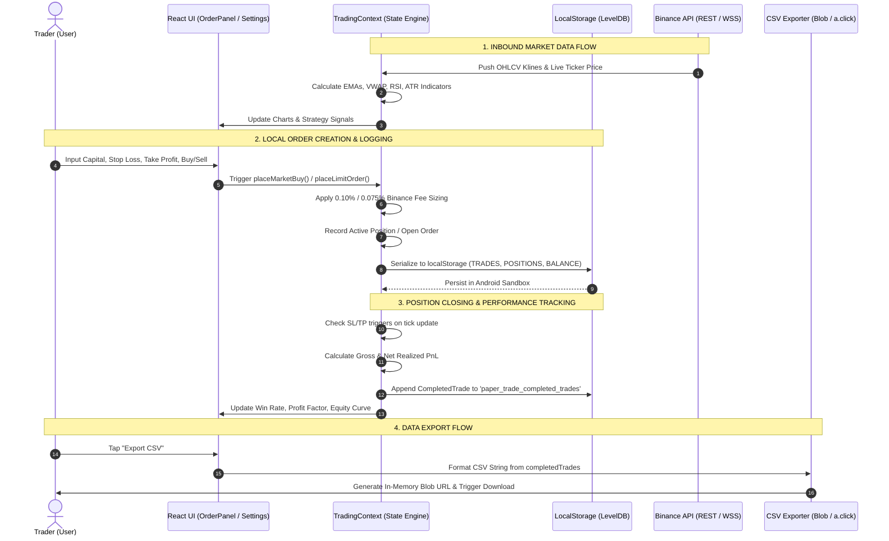

# DATA-FLOW & PRIVACY ARCHITECTURE REPORT
**Project:** Binance SOL/USDT Day Trader & Paper Trading App  
**Package ID:** `com.binancetrader.papertrading`  
**Audit Phase:** Phase 1 — Data Flow & Privacy Assessment  
**Date:** October 14, 2026

---

## 1. End-to-End Data Flow Diagram

---

## 2. Inbound Data Flows

| Inbound Stream | Source | Protocol | Authentication | Sensitivity | Destination |
| :--- | :--- | :--- | :--- | :--- | :--- |
| **Historical Candlesticks** | `api.binance.com`, `data-api.binance.vision`, `api1.binance.com` | HTTPS GET (`/api/v3/klines`) | None (Public) | Low (Public Market Data) | In-memory `candles` array in React state |
| **Live Candlestick Stream** | `stream.binance.com:9443` | WSS (`<symbol>@kline_<interval>`) | None (Public) | Low (Public Market Data) | `TradingChart` canvas & indicator engine |
| **Live Ticker Stream** | `stream.binance.com:9443` | WSS (`<symbol>@ticker`) | None (Public) | Low (Public Market Data) | Real-time PnL & Stop-Loss trigger monitor |
| **User Trade Entries** | User Touch Screen (Input fields) | In-App React Event | Local | High (Trading Habits & Journal) | `TradingContext` state engine |
| **Risk & Fee Settings** | User Settings Modal | In-App React Event | Local | Medium (Risk Parameters) | `TradingContext` risk settings state |

---

## 3. Data Processing & Financial Logic

All trade execution and financial metrics are calculated entirely on the client device:

1. **Indicator Calculation ([`indicators.ts`](file:///c:/Users/SERVER-GSM/Desktop/trade/src/utils/indicators.ts)):**
   - Exponential Moving Averages (20 EMA & 50 EMA).
   - Volume Weighted Average Price (VWAP) computed over intraday session bars.
   - 14-period Relative Strength Index (RSI) using Wilder smoothing.
   - Average True Range (ATR) used for volatility-adjusted stop-loss recommendations.

2. **Fee Accounting & Sizing ([`TradingContext.tsx`](file:///c:/Users/SERVER-GSM/Desktop/trade/src/context/TradingContext.tsx#L145-L250)):**
   - Deducts Binance spot transaction fees:
     - Standard: **0.100%** on entry and **0.100%** on exit (`0.0010`).
     - Discount Tier: **0.075%** on entry and **0.075%** on exit (`0.00075`) when BNB discount is toggled.
   - Realized PnL is computed as:
     $$\text{Gross PnL} = (\text{Exit Price} - \text{Entry Price}) \times \text{Quantity}$$
     $$\text{Net PnL} = \text{Gross PnL} - (\text{Entry Fee} + \text{Exit Fee})$$

3. **Position Auto-Exit Evaluation:**
   - Active positions monitor the WebSocket ticker price. If current price falls below Stop Loss or rises above Take Profit, the position is automatically liquidated and logged into `completedTrades`.

---

## 4. Local Persistence Mechanism

All data is stored exclusively in `window.localStorage` within the Android WebView sandbox:

| Storage Key | Data Structure | Purpose |
| :--- | :--- | :--- |
| `paper_trade_usdt_balance` | Float (e.g. `5000.00`) | Current available cash balance |
| `paper_trade_holdings` | Object `{ SOL: 0, BTC: 0, ... }` | Asset token quantities |
| `paper_trade_initial_balance`| Float (e.g. `5000.00`) | Baseline balance used for total % return calculations |
| `paper_trade_open_orders` | Array of `Order` objects | Active limit and pending trigger orders |
| `paper_trade_completed_trades`| Array of `CompletedTrade` objects | Complete historical journal of all executed trades |
| `paper_trade_positions` | Record of `Position` objects | Open trading positions with active entry prices and stops |
| `paper_trade_risk_settings` | `RiskSettings` object | User fee choice, risk % per trade, and slippage settings |

### Storage Characteristics & Limitations:
- **No Native Database:** The app does not utilize SQLite, Room, or Android Jetpack DataStore.
- **Unencrypted Storage:** Data in `localStorage` is serialized as plaintext JSON strings. Anyone with physical access to the device or ADB shell (`run-as`) can read or modify the records directly from:
  `/data/data/com.binancetrader.papertrading/app_webview/Default/Local Storage/leveldb/`
- **Volatile to Browser Clear:** Clearing "App Data" or "Website Storage" in Android settings completely obliterates all trade history unless previously exported via CSV.

---

## 5. Outbound Data Flows & Privacy Verification

A primary objective of this audit was verifying whether any trade data leaves the device:

| Outbound Flow | Destination | Content | Verification Finding |
| :--- | :--- | :--- | :--- |
| **Market Data Polling** | `api.binance.com` | Symbol name, timeframe, candle limit | **Verified Clean:** Only standard market parameters sent; no user identifier, device ID, or trade records transmitted. |
| **Market Data WebSocket** | `stream.binance.com:9443` | WebSocket subscription frames | **Verified Clean:** Anonymous subscription strings; no authentication tokens or user data sent. |
| **User Trade History** | *None* | N/A | **Verified Local-Only:** Zero network calls exist that transmit trade records, balance, notes, or win rates. |
| **Analytics & Crash Reports**| *None* | N/A | **Verified Absent:** No telemetry SDKs (Firebase, Sentry, Mixpanel, Segment) are bundled or called. |
| **CSV Export** | Local File System (Browser Download) | Trade History (CSV text) | Handled client-side via `Blob` and `URL.createObjectURL`. |

> [!NOTE]
> **Privacy Verdict:** The application strictly adheres to a local-first, zero-telemetry architecture. Trade records, capital balances, and trade statistics never leave the local device during normal network operation.
