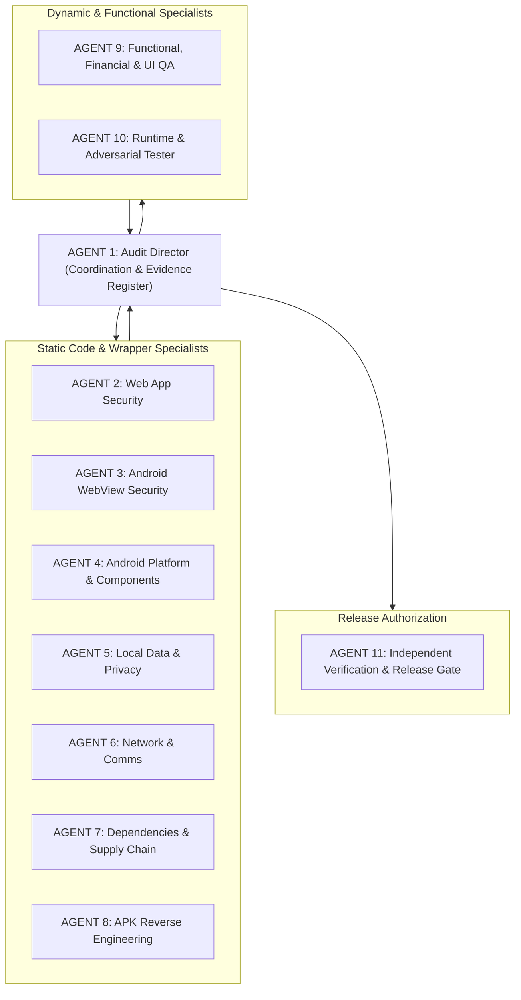

# PROPOSED SPECIALIST AUDIT TEAM CONFIGURATION
**Project:** Binance SOL/USDT Day Trader & Paper Trading App  
**Audit Standard:** OWASP MASVS v2.0 / MASTG  
**Audit Phase:** Phase 1 Deliverable -> Proposal for Phase 2 Deployment

---

## Team Overview & Orchestration Model

To execute Phase 2 through Phase 4 thoroughly and without bias, an 11-member specialist audit team is defined. Each agent operates with specialized domain responsibilities, strict evidentiary standards, and independent verification requirements.

---

## Specialist Roster & Assigned Mandates

| Agent ID | Agent Role | Key Responsibilities | Primary Artifacts |
| :--- | :--- | :--- | :--- |
| **AGENT 1** | **Audit Director** | Coordinates audit execution, assigns tasks, maintains `findings/register.md`, deduplicates findings, identifies testing gaps. | `findings/register.md`, `evidence/README.md` |
| **AGENT 2** | **Web App Security** | Audits React SPA for XSS, DOM sinks, prototype pollution, CSP enforcement, input sanitization, and client logic bypass. | `findings/web-security.md`, XSS test cases |
| **AGENT 3** | **Android WebView Security** | Audits WebView configuration, JavaScript bridge, URL interception, mixed content, cleartext, file access, renderer crash safety. | `test-cases/webview-security.md` |
| **AGENT 4** | **Platform & Components** | Inspects merged manifest, exported components, intent filters, `FileProvider` paths, backup rules, and IPC boundaries. | `findings/platform-security.md` |
| **AGENT 5** | **Local Data & Privacy** | Audits `localStorage`, LevelDB data at rest, unencrypted JSON, ADB extraction risks, clipboard, crash dumps, and CSV exports. | `test-cases/local-data-privacy.md` |
| **AGENT 6** | **Network & Communications** | Inventories and monitors all outbound network traffic, Binance REST/WSS protocols, TLS validation, and checks for telemetry/beacons. | `findings/network-security.md` |
| **AGENT 7** | **Dependencies & Supply Chain** | Analyzes `package.json`, `package-lock.json`, Gradle dependencies, CVE advisories, and malicious install script risks. | `findings/supply-chain.md` |
| **AGENT 8** | **APK Reverse Engineering** | Disassembles and analyzes DEX bytecode, resource tables, embedded URLs, debug signatures, and binary tampering risks. | `test-cases/apk-verification.md` |
| **AGENT 9** | **Functional, Financial & UI QA** | Validates Binance 0.1% / 0.075% fee calculations, 1.5% ATR position sizing, stop-loss triggers, CSV export, edge cases, and UI stability. | `test-cases/financial-qa.md` |
| **AGENT 10** | **Runtime & Adversarial Tester** | Performs controlled runtime tests in isolated emulator: intent injection, offline resilience, storage extraction, app lifecycle tests. | `findings/adversarial-tests.md` |
| **AGENT 11** | **Independent Release Gate** | Re-verifies all findings, validates proposed remediations, reviews test evidence, and issues final release verdict. | `release-gate.md`, `final-release-decision.md` |

---

## Agent Instruction Files

The individual role specifications are preserved in the `audit/agents/` directory:
- [`01-audit-director.md`](file:///c:/Users/SERVER-GSM/Desktop/trade/audit/agents/01-audit-director.md)
- [`02-web-app-security.md`](file:///c:/Users/SERVER-GSM/Desktop/trade/audit/agents/02-web-app-security.md)
- [`03-android-webview-security.md`](file:///c:/Users/SERVER-GSM/Desktop/trade/audit/agents/03-android-webview-security.md)
- [`04-android-platform-components.md`](file:///c:/Users/SERVER-GSM/Desktop/trade/audit/agents/04-android-platform-components.md)
- [`05-local-data-privacy.md`](file:///c:/Users/SERVER-GSM/Desktop/trade/audit/agents/05-local-data-privacy.md)
- [`06-network-external-comms.md`](file:///c:/Users/SERVER-GSM/Desktop/trade/audit/agents/06-network-external-comms.md)
- [`07-dependency-supply-chain.md`](file:///c:/Users/SERVER-GSM/Desktop/trade/audit/agents/07-dependency-supply-chain.md)
- [`08-apk-reverse-engineering.md`](file:///c:/Users/SERVER-GSM/Desktop/trade/audit/agents/08-apk-reverse-engineering.md)
- [`09-functional-financial-qa.md`](file:///c:/Users/SERVER-GSM/Desktop/trade/audit/agents/09-functional-financial-qa.md)
- [`10-runtime-adversarial-tester.md`](file:///c:/Users/SERVER-GSM/Desktop/trade/audit/agents/10-runtime-adversarial-tester.md)
- [`11-independent-release-gate.md`](file:///c:/Users/SERVER-GSM/Desktop/trade/audit/agents/11-independent-release-gate.md)

---

## Non-Negotiable Operational Rules for Phase 2

1. **Evidentiary Standard:** No agent may declare a vulnerability or safety claim without reproducing the steps and recording exact file paths, line numbers, or packet logs.
2. **Read-Only Preservation:** Agents 1 through 10 operate in strictly read-only audit mode. No code modifications or dependency updates will occur until the findings register is presented and approved.
3. **Safety Isolation:** Runtime testing (Agent 10) will be restricted to an authorized Android Virtual Device (AVD). No tests will be executed on personal physical phones.
